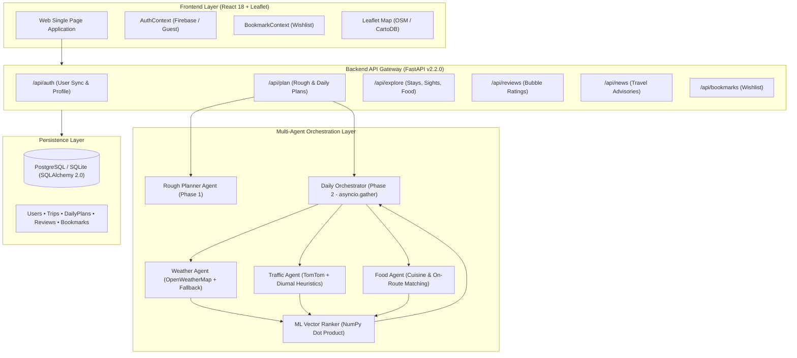
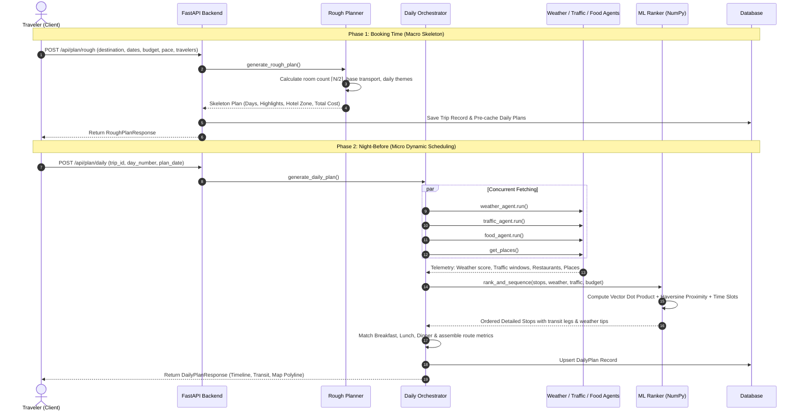
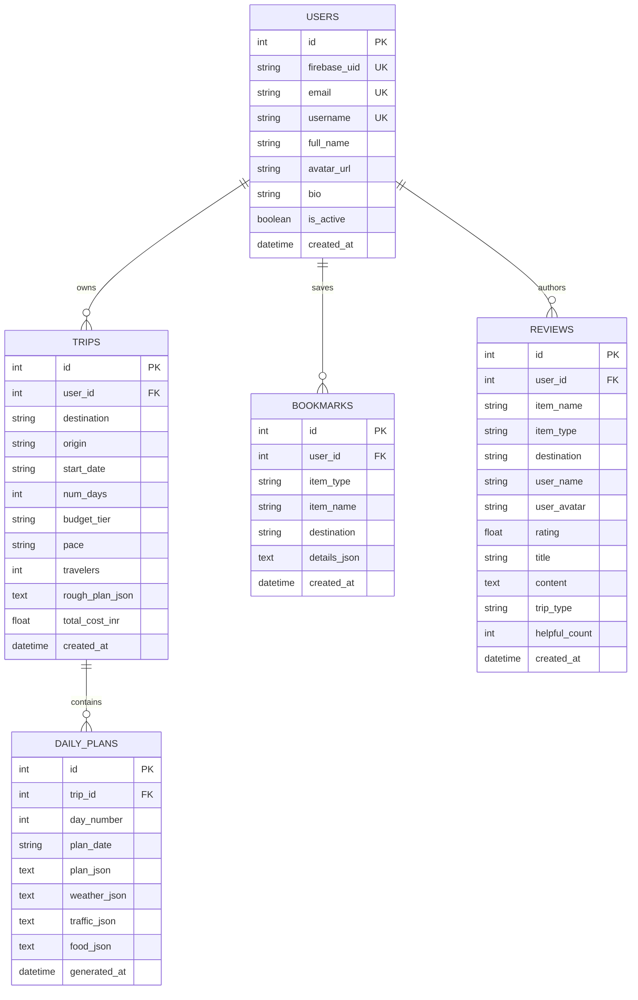

# TripPilot – Intelligent Multi-Agent Travel Partner & Smart Travel Guide
## Major Project Report & Complete Technical Documentation
**Version:** `2.2.0`  
**System Classification:** Autonomous Multi-Agent AI System & Geospatial Web Platform  
**Target Architecture:** Python 3.10+ / FastAPI / NumPy / SQLAlchemy / React 18 / Leaflet / PostgreSQL & SQLite / Docker  

---

## Table of Contents
1. [Project Overview & Abstract](#1-project-overview--abstract)
2. [Problem Statement & Objectives](#2-problem-statement--objectives)
3. [System Architecture & Multi-Agent Design](#3-system-architecture--multi-agent-design)
4. [Two-Phase Planning Workflow](#4-two-phase-planning-workflow)
5. [Agent Specifications & Intelligence Engine](#5-agent-specifications--intelligence-engine)
6. [Machine Learning & Algorithmic Formulations](#6-machine-learning--algorithmic-formulations)
7. [Database Architecture & Data Models](#7-database-architecture--data-models)
8. [Comprehensive REST API Reference](#8-comprehensive-rest-api-reference)
9. [Frontend Architecture & Component System](#9-frontend-architecture--component-system)
10. [Security, Authorization & Privacy](#10-security-authorization--privacy)
11. [Automated Testing & Verification](#11-automated-testing--verification)
12. [Setup, Deployment & Execution Manual](#12-setup-deployment--execution-manual)
13. [Key Highlights for Evaluation & Viva](#13-key-highlights-for-evaluation--viva)

---

## 1. Project Overview & Abstract

### 1.1 Abstract
**TripPilot** is a next-generation, AI-driven travel planning platform engineered to eliminate the static rigidity, spatial inefficiency, and budgeting inaccuracy common to existing travel planners. While conventional systems treat itinerary generation as a static database lookup, TripPilot introduces a **Two-Phase Multi-Agent Architecture**:
- **Phase 1 (Booking Time / Macro-Level):** Creates a budget-constrained skeleton itinerary with daily themes, realistic room-sharing budgeting, and geographic zoning.
- **Phase 2 (Night-Before / Micro-Level):** Concurrently orchestrates a **Weather Agent**, a **Traffic Agent**, a **Food Agent**, and a **Geospatial Places Service** using Python's asynchronous parallel execution (`asyncio.gather`). These telemetry streams are fed into a **Vectorized Machine Learning Ranker (NumPy)** that dynamically scores and sequences stops based on weather suitability, diurnal traffic patterns, landmark popularity, and Haversine spatial proximity.

The user-facing system is built with **React 18** and **Leaflet**, utilizing 100% free and open-source CartoDB/OpenStreetMap tiles (requiring zero proprietary billing keys). It features TripAdvisor-style community bubble ratings, travel advisory news feeds, and private wishlist storage with strict row-level authorization (IDOR protection).

---

## 2. Problem Statement & Objectives

### 2.1 Problem Statement
1. **Static Scheduling Failures:** Standard travel applications generate rigid itineraries weeks in advance. When sudden monsoon rains or midday heatwaves occur, travelers are sent to outdoor venues with no automated contingency adaptation.
2. **Traffic-Blind Sequencing:** Attractions are typically organized alphabetically or by popularity alone, forcing travelers into severe city-wide backtracking during peak rush hours.
3. **Flawed Cost Estimations:** Most tools calculate lodging on an inflexible per-person basis rather than modeling true room sharing ($\lceil N / 2 \rceil$), and neglect localized transit mileage rates.
4. **Proprietary API Dependencies:** Many commercial platforms depend on expensive map APIs that require paid subscriptions or watermarked tiles.

### 2.2 Project Objectives
- **Dynamic Re-ranking:** Construct an ML ranking engine that dynamically balances five distinct real-world factors (weather, traffic, popularity, proximity, budget).
- **Parallel Multi-Agent Concurrency:** Run independent domain agents simultaneously using non-blocking asynchronous coroutines (`asyncio.gather`) to keep response times sub-second.
- **Zero-Cost & Resilient Operations:** Ensure complete system functionality through free OpenStreetMap tiles and built-in fallback heuristic models when external APIs are unavailable.
- **Comprehensive Security:** Protect user privacy by preventing Insecure Direct Object References (IDOR) through authenticated row-level ownership checks.

---

## 3. System Architecture & Multi-Agent Design

### 3.1 Architectural Diagram



---

## 4. Two-Phase Planning Workflow



---

## 5. Agent Specifications & Intelligence Engine

### 5.1 Rough Planner Agent (`app/agents/rough_planner.py`)
- **Responsibility:** Produces the overarching framework upon trip creation.
- **Budget Realism:** Calculates party room count using:
  $$\text{rooms\_needed} = \left\lceil \frac{\text{travelers}}{2.0} \right\rceil$$
- **Transport Realism:** Models fixed base vehicle costs combined with mileage and party scaling:
  $$\text{Transport Cost} = \text{base\_transport} + 20 \times \text{rate\_per\_km} \times (1 + 0.25 \times (\text{travelers} - 1))$$
- **Pacing Engine:** 
  - `relaxed`: 2 stops/day (2.0 hours per activity)
  - `balanced`: 4 stops/day (1.5 hours per activity)
  - `fast`: 6 stops/day (1.0 hour per activity)

### 5.2 Weather Agent (`app/agents/weather_agent.py`)
- **Responsibility:** Evaluates environmental viability for outdoor exploration.
- **Data Source:** OpenWeatherMap API with automatic seasonal fallback models (`summer`, `monsoon`, `winter`).
- **Suitability Metric:** Produces a continuous score $S_{\text{weather}} \in [0.0, 1.0]$:
  - Base score: $1.0$
  - Temperature penalty: $-0.5$ if $T > 40^\circ\text{C}$, $-0.3$ if $T > 35^\circ\text{C}$, $-0.4$ if $T < 5^\circ\text{C}$.
  - Humidity penalty: $-0.2$ if humidity $> 85\%$.
  - Precipitation penalty: $-0.4$ for heavy rain/snow, $-0.2$ for light showers.
  - Classification: `outdoor_great` ($\ge 0.70$), `outdoor_ok` ($\ge 0.40$), or `indoor_preferred` ($< 0.40$).

### 5.3 Traffic Agent (`app/agents/traffic_agent.py`)
- **Responsibility:** Predicts diurnal urban congestion windows.
- **Data Source:** TomTom Traffic Flow API with city-type historical profiles (`metro`, `tourist`, `hill`).
- **Optimization Output:** Identifies congested rush hours, recommends morning departure times (e.g., 08:30 or 09:00), and outputs congestion coefficients for each hourly window.

### 5.4 Food Agent (`app/agents/food_agent.py`)
- **Responsibility:** Curates Breakfast, Lunch, and Dinner options.
- **Filtering & Routing:** Matches traveler budget tier (`$`, `$$`, `$$$`) and prioritizes restaurants located directly along the routed travel path (`on_route = True`).

### 5.5 Daily Orchestrator (`app/agents/daily_orchestrator.py`)
- **Responsibility:** Concurrently invokes Weather, Traffic, Food, and Geospatial Places modules using `asyncio.gather`.
- **Enrichment:** Computes transit legs, timing windows, weather tips, curator badges, and route summaries before caching into the database.

---

## 6. Machine Learning & Algorithmic Formulations

The ML Ranker (`app/ml/ranker.py`) scores, orders, and schedules candidate attractions for each day.

### 6.1 Vectorized Multi-Factor Scoring Formula
Given $N$ candidate attractions for a specific day, a feature matrix $\mathbf{F} \in \mathbb{R}^{N \times 5}$ is constructed. Each stop $j$ receives a composite score:

$$\text{Composite Score}_j = \mathbf{F}_j \cdot \mathbf{W} = \sum_{i=1}^{5} f_{j,i} \cdot w_i$$

Where the static weight vector $\mathbf{W}$ is:
$$\mathbf{W} = \begin{bmatrix} 0.30 & 0.25 & 0.20 & 0.15 & 0.10 \end{bmatrix}^T$$

| Factor ($i$) | Feature | Weight ($w_i$) | Normalization & Evaluation Logic |
|:---:|:---|:---:|:---|
| **1** | Weather Suitability | **0.30** | Weather score from Weather Agent. If condition is `indoor_preferred` and the stop is outdoor (beach, fort, viewpoint), score is penalized by $-0.45$. |
| **2** | Traffic Flow Factor | **0.25** | Clear road factor at the visit time slot ($1.0$ = clear, $0.0$ = gridlock). |
| **3** | Landmark Popularity | **0.20** | Verified landmark score ($0.65$ to $1.00$, e.g., Taj Mahal = 1.0, Amber Fort = 0.95). |
| **4** | Haversine Proximity | **0.15** | Normalized distance score from the preceding location (decreases transit overhead). |
| **5** | Budget Compatibility| **0.10** | Ratio of stop entry fee relative to expected tier budget. |

The final score is scaled and clipped to a 10-point scale:
$$\text{Score}_{j} = \text{clip}\left(\text{Composite Score}_j \times 10,\; 1.0,\; 10.0\right)$$

### 6.2 Spatial Haversine Distance & Transit Routing
Between coordinates $(\phi_1, \lambda_1)$ and $(\phi_2, \lambda_2)$ in radians:

$$a = \sin^2\left(\frac{\Delta \phi}{2}\right) + \cos(\phi_1)\cos(\phi_2)\sin^2\left(\frac{\Delta \lambda}{2}\right)$$
$$c = 2 \cdot \text{atan2}\left(\sqrt{a}, \sqrt{1-a}\right)$$
$$d_{\text{haversine}} = R \cdot c \quad (R = 6371.0 \text{ km})$$

To simulate urban street networks:
$$d_{\text{urban}} = \max\left(d_{\text{haversine}} \times 1.3,\; 0.6 \text{ km}\right)$$

Travel time is determined by congestion velocity $v$:
$$\text{Transit Minutes} = \max\left(5,\; \text{round}\left(\frac{d_{\text{urban}}}{v} \times 60\right)\right)$$
- Heavy congestion: $v = 15\text{ km/h}$
- Moderate congestion: $v = 22\text{ km/h}$
- Low congestion: $v = 34\text{ km/h}$
- Transit Mode: Walk if $d_{\text{urban}} \le 0.8\text{ km}$, otherwise Drive.

---

## 7. Database Architecture & Data Models

Built using **SQLAlchemy 2.0** with foreign key constraints and cascade deletions.



---

## 8. Comprehensive REST API Reference

Interactive Swagger UI is available at `/docs`, with Redoc at `/redoc`.

### 8.1 Planning & Itinerary Endpoints (`/api/plan`)
- `POST /api/plan/rough`: Accepts `TripRequest`, generates Phase 1 skeleton, saves trip to database, pre-computes initial daily plans, and returns `RoughPlanResponse`.
- `POST /api/plan/daily`: Accepts `DailyPlanRequest`, triggers Phase 2 agents + ML ranker, upserts daily plan in database, and returns `DailyPlanResponse`.
- `GET /api/plan/trips`: Lists trips with user isolation. Authenticated users see only their trips; unauthenticated users see public demo trips.
- `GET /api/plan/trips/{id}`: Returns trip details and the rough plan JSON.
- `DELETE /api/plan/trips/{id}`: Deletes a trip. Enforces strict owner verification (`403 Forbidden` if unauthorized).
- `GET /api/plan/trips/{id}/daily/{d}`: Retrieves the detailed daily plan for day $d$. Features **automatic 15-minute telemetry freshness** and supports `?refresh=true` to force real-time weather and traffic updates.

### 8.2 Real-Time Telemetry & Live Streams
- `GET /api/weather/{destination}`: Fetches real-time weather telemetry with temperature, apparent temperature, humidity %, wind speed, outdoor suitability score, and source attribution (OpenWeatherMap / Open-Meteo / Diurnal Climatology).
- `GET /api/traffic/{destination}`: Returns current real-time urban congestion level, congestion score, best hourly windows, avoid times, and recommended departure window (TomTom Flow / Diurnal Traffic Intelligence).

### 8.3 Authentication & User Endpoints (`/api/auth`)
- `POST /api/auth/sync`: Synchronizes Firebase Auth or guest traveler accounts with the internal user table.
- `GET /api/auth/me`: Returns the profile of the current authenticated user.
- `PUT /api/auth/profile`: Updates user profile information (bio, display name, avatar).

### 8.4 Explore, Reviews & Community Endpoints
- `GET /api/explore/destinations`: Returns list of curated destinations with metadata.
- `GET /api/explore/hotels`: Filters lodging by destination, tier (`budget`, `mid`, `luxury`), and rating.
- `GET /api/explore/attractions`: Filters landmarks, forts, beaches, and cultural monuments.
- `GET /api/explore/restaurants`: Filters restaurants by destination and price band.
- `GET /api/reviews`: Returns community reviews with calculated average rating and star distribution.
- `POST /api/reviews`: Submits a traveler review with trip classification (`Solo`, `Couples`, `Family`).
- `GET /api/news`: Fetches live rolling travel bulletins, weather advisories, and festival calendars (supports `?refresh=true`).
- `GET /api/news/alerts`: Retrieves urgent alerts for live tickers.
- `POST /api/news/refresh`: Forces an immediate re-fetch and cache invalidation for live travel news.
- `GET /api/bookmarks`: Retrieves user's saved wishlist of places.
- `POST /api/bookmarks`: Saves a place to the wishlist.
- `DELETE /api/bookmarks/{id}`: Removes an item from the wishlist.

---

## 9. Frontend Architecture & Component System

### 9.1 Technical Stack
- **Framework:** React 18.2 with React Router v6.22
- **Mapping:** Leaflet 1.9.4 & React-Leaflet 4.2.1
  - CartoDB Voyager tiles (100% free, zero cost, no watermark)
  - Custom HTML numbered pins (`#1, #2, #3, #4`), Hotel pin (`🏨`), Food pins (`🍴`), and route polyline loops
- **State Management:** React Context API (`AuthContext` and `BookmarkContext`)
- **HTTP Client:** Axios with base URL proxying and JWT bearer token injection

### 9.2 Frontend File Structure
```
frontend/src/
├── context/
│   ├── AuthContext.js        # JWT tokens, Firebase Auth, and 1-Click Guest Demo
│   └── BookmarkContext.js    # Global wishlist state synchronized with API
├── components/
│   ├── Navbar.js             # Navigation header with auth profile and quick links
│   ├── DailyPlanView.js      # Detailed day view: Weather/traffic briefing, timeline, stops, transit legs
│   ├── ItineraryView.js      # Macro skeleton overview from Phase 1
│   ├── TripMap.js            # Sticky interactive Leaflet map with routing polyline
│   ├── RatingBubbles.js      # TripAdvisor-style green bubble rating display
│   ├── PlaceModal.js         # Modal for viewing place details and posting reviews
│   ├── NewsTicker.js         # Real-time travel bulletin ticker
│   └── ProtectedRoute.js     # Route guard for dashboard and user pages
└── pages/
    ├── HomePage.js           # Hero landing page, feature showcase, and curated city cards
    ├── PlannerPage.js        # Multi-step AI trip generator (destination, dates, budget, pace)
    ├── TripDetailPage.js     # Day-by-day interactive itinerary & map view
    ├── TripsPage.js          # Saved trips management (view, delete, export)
    ├── ExplorePage.js        # Directory of stays, dining, and attractions with search
    ├── SavedPage.js          # Traveler wishlist (saved places)
    ├── NewsPage.js           # Travel advisories, weather notices, and local festivals
    ├── DashboardPage.js      # User account profile and activity overview
    ├── LoginPage.js          # Authentication (Google, Email/Password, 1-Click Guest)
    └── RegisterPage.js       # New user account registration
```

---

## 10. Security, Authorization & Privacy

1. **IDOR (Insecure Direct Object Reference) Protection:**
   - Any attempt to delete or alter a trip owned by another user is rejected with `HTTP 403 Forbidden`.
2. **Data Isolation:**
   - Unauthenticated guests can only view public demo trips. Authenticated users' private plans are strictly isolated using `Trip.user_id == current_user.id`.
3. **Resilience & Fault Tolerance:**
   - The platform operates with **zero mandatory external API keys**. If external services are unreachable or unconfigured, the system automatically falls back to internal simulation models.
4. **Input Validation:**
   - All inputs are validated via Pydantic v2 schemas to prevent injection attacks and malformed payloads.

---

## 11. Automated Testing & Verification

The project includes an automated test suite executed via Python's `unittest` framework:

```bash
cd "smart-travel-guide/backend"
python3 -m unittest discover -s tests -p "test_*.py" -v
```

### Verified Test Modules
- `tests/test_ml_ranker.py`:
  - Validates great-circle Haversine distance accuracy against known geographic coordinates.
  - Verifies composite scores stay bounded between $1.0$ and $10.0$.
  - Asserts that outdoor venues are penalized under adverse weather (`indoor_preferred`).
  - Confirms graceful handling of empty stops.
- `tests/test_plan.py`:
  - Validates Phase 1 rough planning and party room count calculations ($\lceil N / 2 \rceil$).
  - Verifies Phase 2 parallel agent execution, transit leg generation, and itinerary caching.
  - Confirms IDOR rejection on unauthorized deletion attempts.
- `tests/test_auth.py`:
  - Verifies user synchronization, unique username generation, and token management.
- `tests/test_explore_and_reviews.py`:
  - Verifies hotel, attraction, and restaurant filters, and checks bubble rating computations.
- `tests/test_database.py`:
  - Verifies relational integrity, foreign key cascades, and database connectivity.

---

## 12. Setup, Deployment & Execution Manual

### 12.1 Prerequisites
- **Python 3.10+** (Tested on Python 3.12)
- **Node.js 18+** & **npm**
- **Docker & Docker Compose** (Optional, for containerized run)

### 12.2 Backend Execution
```bash
# 1. Navigate to backend directory
cd "smart-travel-guide/backend"

# 2. Set up virtual environment
python3 -m venv ../venv
source ../venv/bin/activate

# 3. Install Python dependencies
pip install -r requirements.txt

# 4. Start the FastAPI development server
uvicorn app.main:app --reload --host 127.0.0.1 --port 8000
```
- Health Check: `http://127.0.0.1:8000/health`
- Interactive API Docs: `http://127.0.0.1:8000/docs`

### 12.3 Frontend Execution
```bash
# 1. Open a new terminal tab and navigate to frontend
cd "smart-travel-guide/frontend"

# 2. Install Node dependencies
npm install

# 3. Start React application
npm start
```
- Web Application: `http://localhost:3000`

### 12.4 Docker Compose Deployment
```bash
# From the project root:
docker compose up --build
```
- Frontend: `http://localhost:3000`
- Backend: `http://localhost:8000`
- PostgreSQL: `localhost:5432`

---

## 13. Key Highlights for Evaluation & Viva

When presenting TripPilot for academic evaluation, project review, or viva examination, highlight the following design decisions:

1. **Two-Phase Architecture:** Solves the core challenge of travel planning by separating macroscopic booking-time plans from dynamic night-before adaptation.
2. **Parallel Concurrency (`asyncio.gather`):** Demonstrates high-performance Python concurrency by executing Weather, Traffic, Places, and Food agents in parallel rather than in sequence.
3. **Vectorized ML Algorithm:** Uses NumPy for multi-factor dot product scoring across weather, traffic, popularity, spatial proximity, and budget.
4. **Spatial Haversine Logistics:** Implements spherical trigonometry with urban winding factors and congestion velocities to calculate realistic drive and walk times.
5. **Party-Aware Budgeting:** Correctly calculates room sharing ($\lceil N / 2 \rceil$) and base transport charges rather than using naive per-person multipliers.
6. **Zero-Cost & Open-Source Mapping:** Uses Leaflet and OpenStreetMap/CartoDB tiles, making the system 100% free to run without proprietary map subscriptions.
